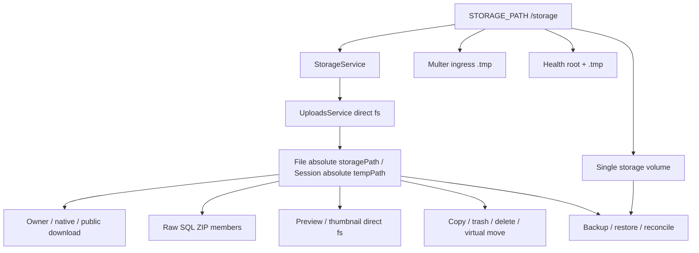
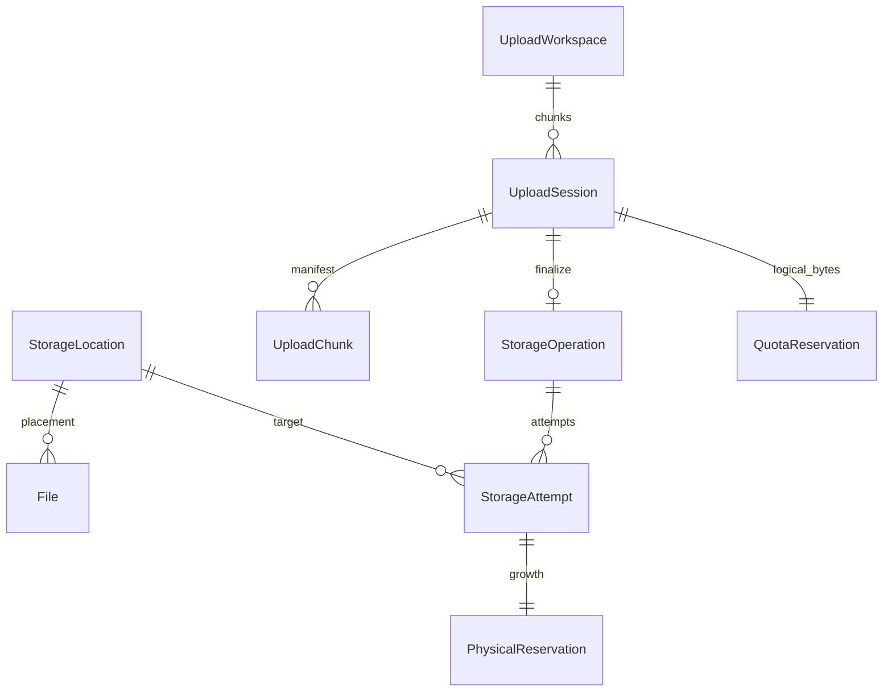
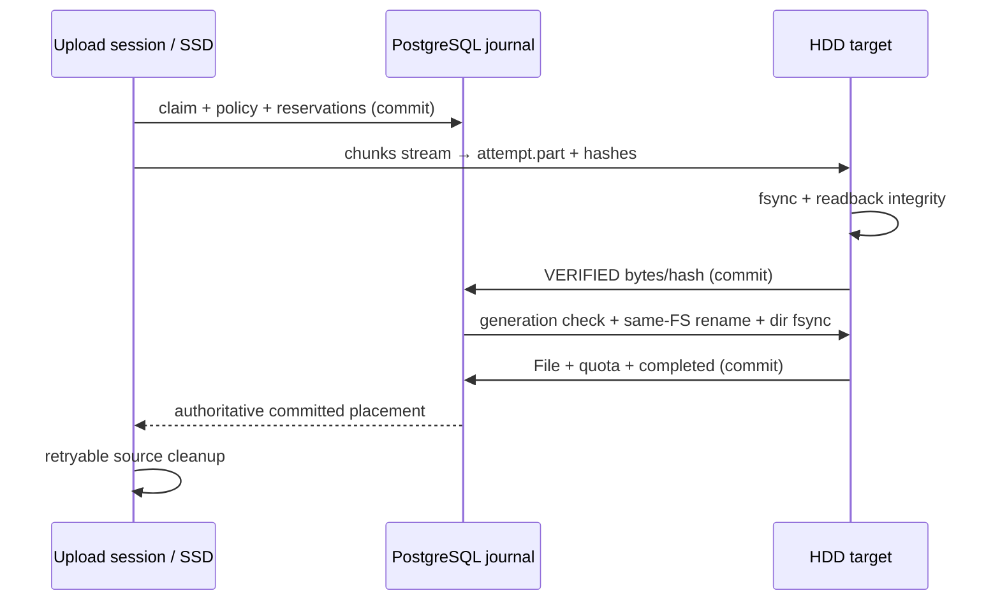
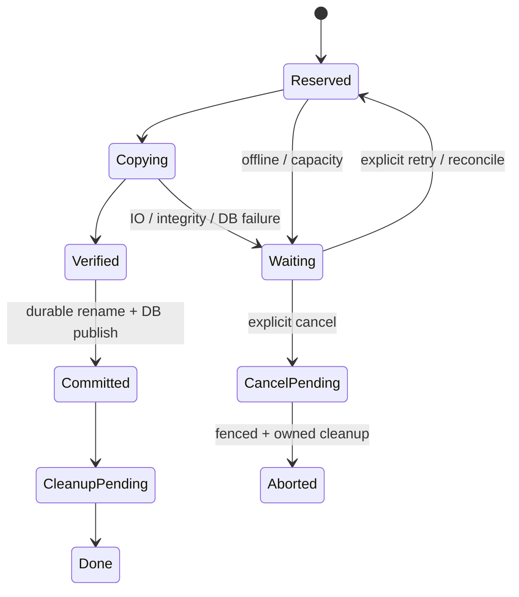

# HomeCloud — аудит и проект многотомного хранения

Дата аудита: 2026-10-06, Asia/Vladivostok. Обновление: 2026-10-10.
Статус дизайна: **OWNER_APPROVED**. Первый implementation checkpoint
**Schema & Legacy Compatibility: COMPLETE**; **MS-2 Registry & Secure Resolver: COMPLETE**
в owner-approved ограниченном trusted legacy профиле; **MS-3A Upload Workspace Architecture & Session Binding: COMPLETE**
в том же legacy профиле. MS-3B и остальные checkpoints не реализованы.
Это ненумерованный workstream. Production остаётся **NOT_READY / NO_GO**.
Разделы 1–15 сохраняют исходный аудит и целевой дизайн; утверждение ниже фиксирует
фактическую реализацию и отдельно разрешённый владельцем scope.

### Выполненный checkpoint — Schema & Legacy Compatibility

Добавлены минимальный StorageLocation и logical File placement; deterministic
`legacy-storage` (`f2f5c4b0-8d57-4c49-9f8c-0d095b344601`) представляет текущий `/storage`.
Источник истины — `storageLocationId + relativeObjectKey`; retained storagePath является
строго проверяемым bridge без absolute fallback. FK RESTRICT, UNIQUE pair, placement/identity
triggers, fail-closed backfill и необходимый legacy resolver реализованы. `synchronize`
отключён; обновление схемы только явной migration с fenced writer и видимым storage.

Canonical migration: 6 File сохранились, все 5 физических получили placement, folder
остался без него. Recoverable backup, isolated migration, down refusal и старый/new-schema
dump restore проверены; исходные строки и полный FS inventory совпали. Перенос bytes: **0**.
Full backend с real PostgreSQL: **65 suites / 858 tests PASS**, lint/typecheck/build PASS;
runtime API smoke и четыре healthy preview контейнера подтверждены. A/B/C review: ACCEPT.
[Подробный отчёт, доказательства и границы](evidence/multi-storage-schema-20261010/report.md).

Для этого checkpoint выбран portable trusted exclusive-directory профиль: symlink chain
отвергается, существующие download FD guards сохранены; race-free openat2 не заявлен.
UploadSession.tempPath/chunks остаются legacy exception, workspace/finalizer не изменены.
Root/mount — deployment binding; bridge trigger запечатывает текущий root до отдельно
квалифицированного remap. Минимальная schema не вводит будущие capacity/policy/admin поля.

Owner-approved решения следующих работ: fixed default + min-free reserve + ordered
fallback в policy v1; multiple locations и design-ready workspaces с одним default в первой
поведенческой реализации; admin/bootstrap позднее, UI выбирает только approved mount key;
secondary offline → DEGRADED; удаление location через drain/zero references; final SHA-256
при вычислении finalizer без обязательного rehash старых files; workspace не ordinary backup
payload. True SSD→HDD 50 GiB acceptance остаётся будущим обязательным gate.
Следующие checkpoints требуют отдельного разрешения; второй диск, policy runtime, admin/UI,
mount changes и cross-filesystem финализация в этом checkpoint не добавлялись.

### MS-2 — Registry & Secure Resolver: COMPLETE, фактический профиль

Owner scope допускает отсутствие native secure-open при явном fail-closed. Реализован
operator-only immutable registry с approved root/mount keys, marker bootstrap, exact Linux
mountinfo/root/statfs/marker process identity pin и проверкой capabilities. Production
legacy требует non-root Linux + заранее provisioned marker; startup не создаёт root/marker.
Missing/swapped identity, ordinary fallback directory, nested/stacked mounts блокируются.
Marker FD anchor предотвращает inode reuse в lifetime process; физический диск хоста,
clone+restart, NFS reconnect/durability и hostile mount mutations не аттестованы.

Logical resolution отделено от safe descriptor opening: **secureOpen=false**, openSecure
отказывает. Node20 не имеет штатного openat2/dirfd API; realpath эквивалентом не объявляется.
Legacy сохраняет trusted exclusive-directory профиль с оставшимся check→open TOCTOU;
новые/untrusted locations **не включены для bytes**. Secure descriptors всех consumers и
capacity-domain qualification остаются будущими blocking gates до расширения доверия.
StorageService, Health, Multer и существующие direct upload FS entry guards подключены
к identity/confinement; File placement bridge/schema/IDs и chunk/finalizer protocol сохранены.

[Операторский контракт и границы гарантий](storage-registry-operations.md),
[MS-2 evidence](evidence/multi-storage-registry-20261010/report.md). Production NO_GO;
MS-3 не начинается автоматически.

### MS-3A — Upload Workspace Architecture & Session Binding: COMPLETE

Minimal `upload_workspaces` с deterministic UUID `87798389-88af-4ea5-a3e7-8e69a3c7bb01`,
`legacy-upload-workspace`/approved `legacy-storage`; legacy workspace — `/storage/.tmp`.
Session FK NOT NULL/RESTRICT, immutable workspace identity и session binding; абсолютный
`tempPath` сохранён как exact bridge. Backfill 21/21 sessions, все старые поля/IDs/accounting
и quota semantics сохранены. Schema теперь11 tables/22 migrations; bytes moved **0**.
DB/API paths не выбирают root; missing/swapped/unapproved workspace fail closed без fallback.

Ingest до Multer проверяет session binding, остальные lifecycle/recovery/cleanup используют
ту же привязку. `.tmp` FD dev/ino anchor удерживается в lifetime процесса; production не
создаёт отсутствующий workspace. Ingress/chunks только одна legacy FS: rename adoption,
EXDEV отказ без copy fallback. Existing finalizer сохранён. `.tmp` identity между restart,
secure-open и физическая host qualification не появились; **secureOpen=false**, TOCTOU
остаётся. MS-3B/второй диск/policy/admin/UI/cross-FS и Docker mount changes запрещены.

Verified fenced backup + отдельный private `.tmp` snapshot, isolated DB migration/restore,
old/new dumps и down refusal PASS; canonical rows/bytes exact equal. После runtime startup
старый AuthService штатно удалил12 истёкших refresh tokens (55→43), что отдельно доказано
по backup; session/chunk/File/share/quota invariants сохранены. Full Linux backend68 suites/
917 tests PASS, 0 skips, real PostgreSQL9 suites, lint/typecheck/build PASS. Runtime small
pause/reload/resume/429/quota/cancel/expiry/recovery + byte/download/share smoke PASS;
три независимых scoped reviews ACCEPT, максимум2 раунда исправлений.

[Операторский контракт](upload-workspace-operations.md),
[MS-3A evidence и процессное отклонение](evidence/upload-workspace-20261010/report.md).
Production **NOT_READY / NO_GO**; следующий checkpoint — MS-3B Secure Workspace Activation
только по отдельному разрешению владельца. В этом запросе работа остановлена после MS-3A.

## 1. Исходное состояние и границы аудита

- Репозиторий: `/Users/aleksejkozemakin/Desktop/HomeCloud`, ветка `main`.
- Начальный HEAD и локальный `origin/main`: `07d06e10b3987fef26c1c78e6449b05cf5ec6eef`
  («Добавить открытую лицензию MIT»). Read-only `ls-remote` подтвердил такой же удалённый main.
- `v0.9.0-local.1`: неизменённый annotated tag object
  `4e9e09390449df68b971615f677796aa4829ea85`, commit тега
  `0ae55cb7a93f079fb7c671f14ea99a5bb943e8a0`. Эти два SHA имеют разное значение.
- Tracked tree первоначально чист. Сохранены три untracked:
  `docs/evidence/frontend-functional/closure-checkpoint.json`,
  `docs/evidence/frontend-functional/closure-controls.json`,
  `scripts/tests/PHASE-5.3.1-TEST-AUDIT.md`. Последний не читался и не изменялся.
- Read-only Docker inventory: только четыре контейнера `homecloud-preview`
  (ingress, frontend, backend, db), все healthy. Backend mount:
  `homecloud-preview_storage_data` → `/storage`, RW; DB:
  `homecloud-preview_db_data` → `/var/lib/postgresql/data`.
  Runtime backend user — `nextjs`. Окружение и секреты не выводились.
- Историческая [IAB квалификация 50 ГиБ](evidence/browser-50gib-qualification-20261006/report.md)
  PASS прочитана как evidence: 5120 частей, resume, download, совпадение трёх SHA-256,
  cleanup и сохранение исходных данных. Здесь она не повторялась.
- Аудит — статическое чтение кода/скриптов/тестов плюс перечисленные read-only Git/Docker
  проверки. Не проверялись заново данные БД, содержимое storage volume, restore, реальные
  power-loss сценарии или физическая топология дисков. Healthy не доказывает durability.
- Разрешены только этот документ и ссылка из ROADMAP, один русский docs commit без push.
  Изменений кода, схемы, migrations, mounts, UI и Docker resources нет.

## 2. Фактическая текущая модель

### 2.1. Карта зависимостей с точными ссылками

Ссылки и номера строк относятся к исходному HEAD выше. Диапазоны приведены в тексте;
ссылка ведёт к началу соответствующего участка.

| Узел | Факт и граница изменения | Код |
|---|---|---|
| StorageService | Один `STORAGE_PATH \|\| /storage`, workspace `.tmp` внутри него; автоматически mkdir отсутствующего root | [storage.service.ts:14](../backend/src/storage/storage.service.ts#L14), 14–35 |
| Физические имена | Генерация пользовательского каталога и deterministic final path по upload UUID, byte-limit basename; не виртуальное дерево папок | [storage.service.ts:45](../backend/src/storage/storage.service.ts#L45), 45–80 |
| FS API | Lexical prefix guard; read/write/stat не унифицированы по security; copy EXCL, unlink ENOENT idempotent | [storage.service.ts:83](../backend/src/storage/storage.service.ts#L83), 83–165 |
| Upload ingress | Multer самостоятельно строит `/storage/.tmp/multipart-ingress`, минуя StorageService; exclusive disk stream, abort cleanup | [uploads.module.ts:37](../backend/src/uploads/uploads.module.ts#L37), 37–57; [abortable-disk-storage.ts:13](../backend/src/uploads/abortable-disk-storage.ts#L13), 13–71 |
| Ingress confinement | Проверка временного пути и lstat regular file; cleanup принадлежит ingress namespace | [uploads.service.ts:615](../backend/src/uploads/uploads.service.ts#L615), 615–628; [chunk-ingress.ts:54](../backend/src/uploads/chunk-ingress.ts#L54), 54–73 |
| Session admission | User row lock, logical quota и SUM активных totalSize; абсолютный tempPath | [uploads.service.ts:237](../backend/src/uploads/uploads.service.ts#L237), 237–313 |
| Chunk commit | Session row lock, expected size/SHA-256, ingress rename, sync, atomic chunk rename, sync dir, затем DB/counters | [uploads.service.ts:364](../backend/src/uploads/uploads.service.ts#L364), 364–492 |
| Финализация | Одна длинная DB transaction, запись непосредственно в finalPath, chunk SHA, fsync и File/quota commit | [uploads.service.ts:632](../backend/src/uploads/uploads.service.ts#L632), 632–839 |
| Recovery/expiry | Legacy hydrate, normal reconcile, active list, startup orphan/expired cleanup, hourly expiry | [uploads.service.ts:532](../backend/src/uploads/uploads.service.ts#L532), 532–572; [uploads.service.ts:902](../backend/src/uploads/uploads.service.ts#L902), 902–1139 |
| File placement | `storagePath` varchar(500), фактически абсолютный; size bigint, nullable checksum, integer id, uploadId | [file.entity.ts:22](../backend/src/entities/file.entity.ts#L22), 22–62; [uploads.service.ts:791](../backend/src/uploads/uploads.service.ts#L791), 791–800 |
| Upload metadata | UUID string без unique constraint, абсолютный tempPath; counters/status/expiry; legacy JSON select:false | [upload-session.entity.ts:25](../backend/src/entities/upload-session.entity.ts#L25), 25–95 |
| Chunk metadata | PK `(sessionId,chunkIndex)`, byteSize, SHA-256, cascade при удалении session | [upload-chunk.entity.ts:4](../backend/src/entities/upload-chunk.entity.ts#L4), 4–16 |
| Download | File ownership/deleted checks; lexical + realpath guard, O_NOFOLLOW, fstat, descriptor streaming/range | [files.controller.ts:342](../backend/src/files/files.controller.ts#L342), 342–461 |
| Native download | Capability по file ID, затем тот же download helper; проверка storagePath до выдачи | [native-downloads.controller.ts:45](../backend/src/files/native-downloads.controller.ts#L45), 45–85 |
| Public share | Путь из File, отдельные realpath/O_NOFOLLOW/fstat/range | [sharing.controller.ts:221](../backend/src/sharing/sharing.controller.ts#L221), 221–310 |
| Folder ZIP | Raw SQL возвращает storagePath; архивные имена логические, stream открывает каждый FS path отдельно | [sharing.service.ts:274](../backend/src/sharing/sharing.service.ts#L274), 274–365, 788–826 |
| Preview/thumbnail | Direct stat/readFile/createReadStream по File.storagePath; image limit 5 МиБ; thumbnail вычисляется, постоянного thumbnail root здесь нет | [previews.service.ts:26](../backend/src/previews/previews.service.ts#L26), 26–123 |
| MIME | Заголовок 4100 bytes, fallback UTF-8 читает файл потоково целиком; path consumer вне StorageService | [uploads.service.ts:768](../backend/src/uploads/uploads.service.ts#L768), 768–788; [utf8-plain-text.ts:5](../backend/src/uploads/utf8-plain-text.ts#L5), 5–25 |
| Rename/move | File.name и parentId меняются в metadata; нынешний folder move НЕ переносит bytes | [files.service.ts:267](../backend/src/files/files.service.ts#L267), 267–287, 881–886 |
| Trash/restore | isDeleted/deletedAt, байты остаются там же; quota освобождается лишь permanent delete | [files.service.ts:374](../backend/src/files/files.service.ts#L374), 374–496 |
| Permanent delete | Сначала DB/quota commit, затем best-effort unlink; folder/empty-trash аналогично | [files.service.ts:497](../backend/src/files/files.service.ts#L497), 497–541, 620–648, 745–771 |
| Copy/create | CopyFile EXCL до DB transaction, затем quota+новый File; ambiguous commit lookup; createFile тоже генерирует path | [files.service.ts:171](../backend/src/files/files.service.ts#L171), 171–220, 785–878 |
| Quota/info | User-wide used/quota, атомарные conditional SQL updates; storage-info не физическая ёмкость | [user.entity.ts:35](../backend/src/entities/user.entity.ts#L35), 35–39; [users.service.ts:34](../backend/src/users/users.service.ts#L34), 34–103; [files.service.ts:910](../backend/src/files/files.service.ts#L910), 910–929 |
| Config/startup | Absolute STORAGE_PATH validation; startup config requirement; synchronize вне production | [production-config.ts:63](../backend/src/common/production-config.ts#L63), 63–66; [startup-validation.service.ts:104](../backend/src/common/startup-validation.service.ts#L104); [app.module.ts:24](../backend/src/app.module.ts#L24), 24–40 |
| Health/metrics | DB + один root и `.tmp` write/read probes; 3s response bound; HTTP/process metrics, без domain storage metrics | [health.controller.ts:33](../backend/src/common/health.controller.ts#L33), 33–73, 112–139; [metrics.service.ts:58](../backend/src/common/observability/metrics.service.ts#L58), 58–87 |
| Compose | Production STORAGE_PATH=/storage и один storage_data mount; local override external existing volumes | [docker-compose.production.yml:62](../docker-compose.production.yml#L62), 62–78; [docker-compose.local.yml:19](../docker-compose.local.yml#L19), 19–26 |
| Legacy Compose | Также один root, объявлен неиспользуемый uploads_data; не является каноническим запуском | [docker-compose.yml:51](../docker-compose.yml#L51), 51–61, 94–98 |
| Backup | Один storage archive, exclude `.tmp` и `*.tmp`; volume resolver и local path fallback; metadata format1 | [backup.sh:408](../scripts/backup.sh#L408), 408–430, 533–559, 673–686 |
| Restore | Один STORAGE_VOLUME, `/storage` staging/swap, known schema 7/8/9, затем migrations и reconciliation | [restore.sh:268](../scripts/restore.sh#L268), 268–323, 743–773, 780–950 |
| Reconcile | Один `/storage`/volume, DB storagePath, size counts, excludes trash; usage query excludes trash | [reconcile.py:61](../scripts/reconcile.py#L61), 61–108, 140–169, 198–243 |
| Encrypted/offsite | Обёртка legacy артефактов, узкий MEMBER pattern и manifest format1; write-barrier declaration | [backup-production.py:19](../scripts/backup-production.py#L19), 19, 81–85, 136–179; [recovery_config.py:10](../scripts/recovery_config.py#L10) |
| Release/rollback | Exact migration+entity schema marker и applied migration comparison блокируют несовместимый binary | [release-manifest.cjs:18](../scripts/release-manifest.cjs#L18), 18–28, 130–143 |

Это полный перечень найденных production `fs/path` consumers в `backend/src`, включая
MIME helper; `path` в archive name validation и `isAbsolute` config не являются byte I/O.
Прямые вызовы в tests/bench и operations scripts — отдельная поверхность квалификации.
`getStorageUsage` сканирует один пользовательский каталог, однако quota runtime считает
DB, а не результат этого сканирования. В просмотренном runtime нет `statfs`/physical
free-space admission, location-aware reservation, репликации или redundancy.



### 2.2. Тесты и evidence, зависимые от одного root

| Evidence | Что подтверждает / что потребуется изменить |
|---|---|
| [storage.service.spec.ts:12](../backend/src/storage/storage.service.spec.ts#L12), 12–17,144–156 | Один mkdtemp root/STORAGE_PATH и lexical copy confinement; не isolation нескольких roots |
| [uploads.service.postgres.spec.ts:429](../backend/src/uploads/uploads.service.postgres.spec.ts#L429), 429–461 | Orphan chunk retry/counter repair в одном temp FS |
| [uploads.service.postgres.spec.ts:464](../backend/src/uploads/uploads.service.postgres.spec.ts#L464), 464–498 | Corrupted chunk reject, сохранение retry chunks/quota; не crash между target rename и DB commit |
| [uploads.service.postgres.spec.ts:501](../backend/src/uploads/uploads.service.postgres.spec.ts#L501), 501–548 | Abort/stale cleanup нынешних session paths; нужно operation/workspace-awareness |
| [uploads.scalability.spec.ts:12](../backend/src/uploads/uploads.scalability.spec.ts#L12) | 5120 synthetic chunks и complexity, не физический different-FS durability |
| [files.controller.download.spec.ts:244](../backend/src/files/files.controller.download.spec.ts#L244); [sharing.controller.range.spec.ts:358](../backend/src/sharing/sharing.controller.range.spec.ts#L358) | Out-of-root final symlink reject, не ancestor replacement/cross-location isolation |
| [previews.service.spec.ts:41](../backend/src/previews/previews.service.spec.ts#L41) | Preview memory limits, не secure multi-location FD |
| [test-restore-schema.py:49](../scripts/tests/test-restore-schema.py#L49), 49–65 | Known-table generations; понадобится новый exact schema контракт |
| [test-backup-safety.sh:80](../scripts/tests/test-backup-safety.sh#L80); [test-backup-production-drill.sh:78](../scripts/tests/test-backup-production-drill.sh#L78); [test-recovery-config.py:73](../scripts/tests/test-recovery-config.py#L73) | Legacy single-archive/volume/config fixtures, не N-root restore |
| [IAB 50 ГиБ](evidence/browser-50gib-qualification-20261006/report.md) | Нынешний browser+single-root pipeline PASS; не SSD→HDD, NAS или power-loss |

Native-download/PostgreSQL ownership, ZIP HTTP/SQL/archive, file copy/delete и health suites,
backend/bench config/fixtures/FS instrumentation также сохраняют абсолютные placement и
single StorageService mocks. Их адаптация должна проверять поведение нескольких locations,
а не только заменять mock signature. Новые gates: same relative keys разных roots,
workspace ingress EXDEV, absent mount, adversarial symlink parents, stale worker/crash matrix,
shared-pool quota/capacity и full/partial restore. Ни один перечисленный тест здесь не запускался.

### 2.3. Точные нынешние гарантии и ограничения

Chunk write сериализован session row lock. Новый chunk имеет ожидаемый размер, SHA-256,
exclusive temporary path, `fsync(file)`, `rename(temp,chunk)`, `fsync(session directory)`
до insert metadata/counters. Multipart ingress переносится через rename; EXDEV не
обрабатывается специально: cleanup temp, rollback и ingress finally cleanup, ошибка клиенту.
Буферный ingress вариант пишет bytes прямо в temp.

`completeUpload` держит session lock и DB transaction **весь период сборки**. Он удаляет
прежнюю незарегистрированную сборку, открывает deterministic **finalPath** с `wx` и
последовательно подаёт chunk streams в pipeline. Проверяется regular/no-final-symlink,
размер каждой части и итоговый totalSize. SHA-256 части сверяется **только если есть её
DB record**; отсутствие record не отвергает часть. Полный SHA-256 в File.checksum здесь
не записывается. После MIME создаются File и quota update, выполняются file/parent fsync,
session completed и удаление chunk rows; DB commit происходит в withTransaction.
Chunks на диске удаляются после успешного commit. Ошибка внутри callback удаляет свою
неопубликованную сборку до rollback. Ошибка самого commit оставляет неизвестный outcome;
исходные chunks сохраняются, subsequent lookup/retry необходим. Есть idempotent completed
и existing File lookup, но это не полноценный durable finalize journal.

Финализация **не делает rename готового файла** и не имеет собственной EXDEV ветки.
Потоковое чтение одного FS и запись другого возможно технически; текущие resolver,
metadata, cleanup, ingress и operations этого продукта не поддерживают. Риск EXDEV
возникнет при наивной смене workspace без переноса ingress либо при попытке сначала
собрать файл на SSD, затем rename на HDD. Linux отвергает rename между mounted filesystems,
в том числе различными mounts одного FS. [rename(2)](https://man7.org/linux/man-pages/man2/rename.2.html)

Normal reconcile возвращает committed DB chunk rows без повторной disk/hash проверки;
legacy hydrate сканирует и хеширует bytes. Abort/expiry чистят chunks внутри DB transaction
до commit. Startup сохраняет pending/uploading paths, не чистит при DB lookup failure;
hourly timer выполняет expiry. Эти правила нельзя переносить на новый finalizing без
operation-awareness. Удаление старых final assemblies только по deterministic path
нельзя сохранять после появления нескольких destinations/attempts.

`uploadId` индексы сейчас не UNIQUE: [CreateUploadSessionsTable:29](../backend/src/migrations/1746824940000-CreateUploadSessionsTable.ts#L29)
и [AddFileUploadId:16](../backend/src/migrations/1746825080000-AddFileUploadId.ts#L16).
[UploadSessionStatusCheck:23](../backend/src/migrations/1746825050000-UploadSessionStatusCheck.ts#L23)
допускает только pending/uploading/completed/aborted. Все SUM/list/cleanup фильтры
ориентируются на эти состояния. Copy quota update не учитывает active upload SUM:
copy может занять уже логически обещанную upload ёмкость. Это prerequisite общей
reservation модели, а не повод вводить отдельную user quota на каждом диске.

Security неодинаковая: StorageService lexical guard не обнаруживает symlinks;
read/write не вызывают даже его. Downloads/ZIP делают realpath + root check + O_NOFOLLOW
+ fstat, но не доказывают отсутствие race при замене parent. Preview/copy следуют ссылкам.
Чанк lstat проверяет конечный компонент. Это фактические gaps; исправление не входит в
этот checkpoint, но обязательно для нового resolver. `O_NOFOLLOW` ограничен последним
компонентом; Linux openat2 позволяет ограничения на всё разрешение пути.
[openat2(2)](https://man7.org/linux/man-pages/man2/openat2.2.html)

## 3. Целевой контракт и сущности

### 3.1. Базовые инварианты

1. Location — логическое место постоянных объектов; workspace — временные bytes upload;
   policy — выбор места. Ни один не обозначает `/dev/*` или команду mount.
2. File ID, user ownership, shares, capability и виртуальное дерево независимы от placement.
   Переезд сохраняет File.id. Изменение display name/папки обычно не двигает bytes.
3. Placement всегда `(locationId, relativeObjectKey)`, не абсолютный host/container path.
   Пользовательские filename/extension/name сохраняются в metadata; новый физический
   key не строится из пользовательского пути. Расширение не определяет допуск хранения.
4. Нет малого product limit locations. Registry/config и запросы должны поддерживать
   pagination/ограниченную probe concurrency, а не фиксированный массив на 2–5 дисков.
5. Нельзя публиковать File до durable target bytes; нельзя удалять последнюю source copy
   до подтверждённого DB commit. FS и PostgreSQL не образуют одну общую transaction.
6. Logical quota, observed FS space, physical reservations и backup coverage — разные величины.
7. Отсутствующий mount — OFFLINE, никогда mkdir(root)/fallback на root FS. Веб выбирает
   только предварительно разрешённый mountKey.
8. Любая cleanup проверяет authoritative DB, mount identity, placement и ownership;
   при неизвестном outcome/DB outage сохраняет bytes.

### 3.2. Предлагаемая схема (не DDL и не migration)

| Сущность | Поля v1 и смысл |
|---|---|
| StorageLocation | `id UUID PK`; `machineKey` unique immutable ASCII slug; `displayName`; `type=local_filesystem`; `mountKey` immutable approved registry reference; `desiredMode=enabled/disabled/read_only/draining`; `minFreeBytes bigint≥0`; `configVersion bigint`; createdAt/updatedAt timestamptz |
| Location health | `observedState=online/read_only/degraded/offline/full/unknown`, observedAt, errorCode, capacityTotal/free/availableBytes nullable, mountIdentity fingerprint, capabilityResult/version. Кэш telemetry, не источник истины admission; offline не записывает free=0 как измерение |
| UploadWorkspace | `id UUID`, machineKey/displayName, mountKey, relativeNamespace, desiredMode, minFreeBytes, configVersion/timestamps; те же health/capability semantics; default выбирается конфигурацией. Session FK всегда сохраняет конкретный workspace |
| StoragePolicy | `id UUID`, immutable revision/version, mode=fixed, defaultLocationId, ordered fallbackLocationIds, fallbackEnabled=false по умолчанию, workspaceDefaultId, createdAt/actor. Новая revision вместо изменения snapshot активных sessions |
| File | Существующий integer id сохраняется; `storageLocationId UUID FK`, `objectKey text`, size, name, MIME, parent/folder mirror, deleted/version/user/uploadId остаются; `checksum` SHA-256 для новых объектов, `checksumAlgorithm=sha256`; checksum legacy может быть null |
| UploadSession | Старый id/uploadId сохраняются; `workspaceId FK`, `workspaceKey` relative (UUID namespace), immutable policySnapshot+version, `selectedLocationId` nullable до admission finalize, `finalizeOperationId`, existing totals/counters/chunk geometry/expiry, optional clientExpectedSha256. tempPath только transitional legacy field |
| StorageOperation | `id UUID`, kind=finalize/copy/move/delete, sessionId/fileId/userId, currentAttemptId, generation bigint, state, quotaReservationId, policySnapshot, source placement+version, targetLocationId, timestamps, retry/errorCode, cleanup state. v1 реализует finalize и durable deletion cleanup; move/copy reuse позже |
| StorageAttempt | UUID PK, operationId FK, generation UNIQUE per operation, worker lease/heartbeat, target mount identity, target tempKey/finalKey (immutable per attempt), expectedBytes, writtenBytes, actualSha256, state=reserved/copying/verified/published/retired, reservationId, timestamps. Старые attempt rows сохраняются до безопасной очистки |
| PhysicalReservation | UUID, capacityDomainKey, owner operation/session/attempt, resourcePurpose workspace/target/ingress, plannedBytes, materializedBytes estimate, state active/cleanup_pending/released, timestamps. Unique live owner/purpose; отдельный debit для каждого оставшегося artifact |
| QuotaReservation | UUID, userId, operation/session origin unique, logicalBytes, state held/converted/released, timestamps; pending copy/upload общее accounting; move не добавляет logical used |
| Capacity domain | Approved deployment `capacityDomainKey` связывает roots одного backing pool; DB accounting/lock row на domain. Это не пользовательская storage quota. `statfs`/mount metadata проверяют mapping, но st_dev сам по себе не доказывает разные physical pools |

Priority/weight не нужны fixed v1; откладываются до policy с измеримым поведением.
Type/capability не означает поддержку S3: v1 только mounted filesystem с нужными
open/create/stream/fsync/rename semantics. Будущий object backend требует отдельного
commit protocol и qualification, а не реализации через fake path.

Ограничения: FK location/workspace/reservation/operation — RESTRICT для удаления
referenced ресурсов; immutable identity keys; UNIQUE(locationId,objectKey);
UNIQUE uploadSession.uploadId и partial UNIQUE(userId,uploadId) File WHERE uploadId IS NOT NULL
после preflight дублей. Физический File имеет location+key; folder mirror не имеет placement.
Количество bytes в БД — bigint; API decimal-safe serialization и checked conversion,
не неявная потеря точности Number. Legacy supported limits сохраняются до отдельного решения.

Session status v1 остаётся pending/uploading/completed/aborted; progress finalization
берётся из operation journal, session остаётся uploading до атомарного DB publish.
API DTO добавляет finalize state отдельно. Это не позволяет запускать старый cleanup:
все writers/abort/expiry/reconcile/list обязаны смотреть journal. Новый журнал не обходит
rollout gate или старые quota фильтры. Chunk metadata сохраняется до target+DB publish,
затем очистка metadata/bytes идемпотентна.



### 3.3. Lifecycle и offline behavior

Desired mode и observed health — ортогональны: enabled location может быть offline.
Disabled запрещает новые placements, но разрешает чтение существующих и controlled
cleanup при доступном writable FS. Read-only разрешает reads, запрещает writes/delete.
Draining запрещает новые uploads/copies в него, читает старые; evacuation — будущие
journaled moves, не автоматическое удаление. Existing reserved attempts при mode change
останавливаются перед публикацией; администратор может явно разрешить их завершение
как часть перехода, новая конфигурация не меняет target незаметно. OFFLINE/degraded
mount identity mismatch блокирует I/O, не подменяет location другим root.

File на offline location остаётся в listings/trash с availability=offline; download,
share, preview возвращают bounded 503 STORAGE_LOCATION_UNAVAILABLE (без host path),
а не «файл удалён» и не поиск того же key на другом диске. Read-only/full допускают
download. Permanent delete при offline делает durable tombstone+cleanup job с source
placement и освобождает logical quota по прежней семантике; physical bytes/reservation
остаются учтёнными до фактического unlink. Removal location запрещён, пока есть любой
File (включая trash), session/operation/reservation/tombstone или policy reference.

## 4. Upload workspace и ingress

Рекомендация v1: один default workspace для новых sessions, модель и resolver сразу
поддерживают несколько зарегистрированных workspaces. Legacy workspace может оставаться
на время drain; автоматическое balancing новых sessions между workspaces отложено.
Замена default не переносит существующие chunks: session сохраняет workspaceId/key.
При потере workspace до durable target метаданные не восстанавливают bytes — нужен
reupload; при кратковременной недоступности resume ждёт возвращения mount.

Multer нельзя оставить global `.tmp/multipart-ingress`. Перед приёмом request body
проверяются auth, ownership и session/workspace; disk ingress выбирается сервером на
том же filesystem, что session chunks. Пользователь не передаёт путь. Для legacy
session используется её legacy workspace, для нового — выбранный при create.
Ingress exclusive temp, bounded body/chunk/count/rate/concurrency, reserved headroom.
Commit chunk сохраняет нынешний fsync→same-FS rename→directory fsync→DB manifest.
При EXDEV внутри workspace это конфигурационная/capability ошибка; никакого blind
copy/unlink fallback. Все ingress cleanup interceptors становятся workspace-aware.

## 5. Policy v1, quota и capacity admission

| Вариант | Решение |
|---|---|
| Explicit default location | v1: fixed default, явно видимый администратору |
| Sufficient space | v1: admission gate любого кандидата, не отдельное balancing правило |
| Ordered fallback | v1: только admin opt-in, фиксированный порядок UUID/keys в snapshot; default disabled |
| Most-free-space | Позже: требует сопоставимых capacity pools, устойчивого измерения и hysteresis; не round-robin по случайным samples |
| Round-robin/weighted | Позже: durable cursor, lock и справедливость; weight сейчас не вводить |
| Manual administrator | v1: default/policy; per-file migration/move позже |
| User location choice | Позже: разрешённый subset/ACL, offline disclosure и quota; обычный upload принимает policy, не mountKey |

При create session фиксируются workspace и policy revision/candidate order, резервируется
logical S и workspace capacity. Target выбирается при finalize: первый eligible с
достаточным space (default, затем только включённые fallback). Выбор и physical reservation
фиксируются DB до stream. Retry pinned к выбранному target. После начала copy никакого
silent failover; retarget — явная новая attempt после safe retirement старой, с учётом
оставшихся artifacts и уведомлением. До copy target offline/full даёт retryable error,
chunks не исчезают. Если S больше каждого кандидата, файл нельзя разрезать между locations:
v1 один finalized file целиком на одном location.

User invariant: `storageUsed + SUM(held logical reservations) <= storageQuota`.
Trash входит в used, offline files входят в used; quota не зависит от free HDD.
Upload admission и copy используют одну user lock/reservation модель; publish переводит
held→used ровно один раз в общей transaction. Политика смены quota ниже already-used
должна запрещать новые reservations, а не удалять bytes.

Physical admission отдельно: fresh mount validation, available (для runtime UID, не просто
free), FS reserve, domain lock и durable ledger. Корректность не обещает отсутствие ENOSPC
при сторонних writers/FS quotas; runtime errors обязательны. Reserved growth должен
считать ещё не материализованные bytes, иначе statfs available и ledger вычтут temp дважды.
V1 безопасный вариант: при копировании ledger консервативно держит весь remaining debit,
а другие admissions ждут стабильного sampler window (все domain writers paused между
chunks) для атомарного refresh available+materialized progress. Это может временно
занижать доступность, но не разрешает overcommit. После crash неизвестный progress
консервативен до reconcile; occupancy старых temp/final не исчезает по lease TTL.

Порядок blocking locks: user quota row → session/operation (file для move) → capacity domains
в sorted key order → location config. Все admission/admin переходы следуют ему;
длинный streaming не удерживает DB transaction. Lock transaction повторяется при deadlock
с bounded retry. Очередь finalizers имеет конфигурируемые bounded concurrency и bandwidth;
нет ненужного product cap locations.

## 6. Cross-filesystem финализация

### 6.1. Протокол

Идентификаторы и пути фиксируются до записи. Каждый attempt имеет **свой** immutable
final key, например `objects/<userId>/<operationUUID>/<attemptUUID>.blob`, и `.part`
рядом в том же parent. Имя файла хранится в metadata. Unique key исключает overwrite
другой attempt даже при stale worker. Existing final не удаляется «потому что retry».

1. **Reconcile/claim.** Под короткими locks проверить session owner, статус, expiry и
   completed File. Freeze chunk mutation для active operation. Проверить все индексы,
   expected sizes и manifest; orphan durable chunk без DB row принять только после
   hash+geometry validation и durable metadata repair. DB record без disk chunk —
   missing/reupload, а не «успешный finalize». SHA всех manifest entries обязателен.
2. **Reserve.** Выбрать target из snapshot, проверить mode/identity/capabilities и growth
   capacity, записать operation/attempt, reservation, lease и generation. Commit before I/O.
   Создать только внутренние dirs verified mount, обеспечить fsync необходимой parent chain.
3. **Stream.** Вне DB transaction создать owned `.part` с exclusive/no-follow open.
   Последовательно читать chunks через safe descriptors, сверять размер и chunk SHA,
   одновременно whole SHA-256 и total bytes. Bounded backpressure, отсутствие whole-file
   buffer и assembled source file на SSD. Hash mismatch/ENOSPC/EIO/EROFS — остановка,
   никаких File rows и source deletions. MIME metadata не определяет успех integrity.
4. **Verify/durable temp.** Проверить S, optional clientExpectedSha256, завершить stream,
   fsync target fd; errors синхронизации — failure, не warning. Для v1 strict profile
   reread target `.part` с incremental SHA-256 и сравнить с source whole digest; это
   дополнительное чтение, не дополнительная копия. После file sync/readback выполнить
   fsync parent `.part` ДО VERIFIED DB commit, чтобы имя temp было durable; ошибка
   directory sync запрещает VERIFIED. Сохранить actualSha256/S и VERIFIED
   attempt в DB **до rename**. Недоступная БД не разрешает publish/cleanup.
5. **Publish bytes.** Короткая metadata transaction проверяет operation generation,
   current attempt, mount identity/config и reservation. Atomic rename `.part`→own final
   в одном parent target FS, fsync parent. Newly created parents должны быть durable.
   No-overwrite primitive там, где доступен; portable profile допускает обычный rename
   только в exclusively owned namespace с unique attempt key и single authorized publisher;
   existing final запускает reconciliation по operation+S+SHA, не overwrite.
6. **Publish metadata.** После durability target в той же transaction создать единственный
   File placement+checksum, конвертировать logical reserve в used, session completed,
   operation committed/cleanup_pending, target reservation release после materialization.
   Commit — точка API-visible успеха. Response loss возвращает тот же File по uploadId.
7. **Reconcile commit outcome.** Если commit response неизвестен, свежим DB connection
   проверить File/operation. До определённого ответа ни final, ни chunks не удалять.
   Durable final без File — journal orphan: проверить identity/S/SHA и завершить metadata
   transaction или оставить quarantine при несовпадении.
8. **Cleanup.** Только после подтверждённого commit удалять owned workspace chunks/ingress,
   fsync changed directories по strict profile; освобождать workspace capacity после
   подтверждённого reclaim. Cleanup progress durable и повторяемый. File успех не откатывается
   из-за cleanup failure; ошибка видима оператору.

`fsync(file)` не делает directory entry durable; нужен parent fsync. Это контракт strict
profile при поддержке файловой системой, не универсальная гарантия всех NAS и контроллеров.
[fsync(2)](https://man7.org/linux/man-pages/man2/fsync.2.html)

Publication содержит bounded FS metadata operations, но fsync на зависшем NAS не гарантирует
короткую wall-clock transaction. Lease fencing/CAS обеспечивает DB visibility; timeout
response сам по себе не отменяет syscall. V1 storage worker изолирует зависшие I/O,
прекращает admission affected domain и сохраняет reservation. Не запускать competing
attempt с теми же paths; новый key допустим только с отдельным debit оставшихся bytes.

Stale worker может дописать/rename **свой** artifact после потери DB connection/lock;
это не публикует File. Он не способен перезаписать current placement, потому что keys
разные. Любая metadata commit/cleanup проверяет generation+authoritative placement.
Lease expiration не доказывает, что старый writer остановился. После restart recovery
сначала fence old process/I/O и классифицирует attempts, затем пересматривает reservations.



### 6.2. State machine и матрица crash recovery



| Граница сбоя | Авторитетное состояние | Recovery и запрет |
|---|---|---|
| До reserve commit | Нет accepted operation | Новая claim; bytes не создавались |
| После reserve, до `.part` | Journal/reservations | Reclaim lease после fencing; создать свою temp |
| Во время stream | Chunks и partial target | Source сохранить; inspect/delete только owned partial, rebuild; reserve не исчезает автоматически |
| После temp fsync, до VERIFIED DB | Temp без committed digest | Rehash+S against manifest, либо rebuild; не publish непроверенные bytes |
| После VERIFIED, до rename | Journal digest + durable temp | Verify identity+size+hash, publish idempotently |
| Rename succeeded/ошибка ambiguous, до dir fsync | DB File ещё отсутствует | Inspect temp/final; rehash и fsync, rebuild из chunks если нет объекта; не доверять errno как доказательству отсутствия rename |
| После durable rename, до DB commit | VERIFIED journal + final orphan | Adopt только matching target/attempt/S/SHA, commit placement once |
| DB commit outcome неизвестен | Возможно File уже есть | Свежий authoritative lookup; DB недоступна → preserve всё, не subtract quota twice |
| После DB commit, до source cleanup | File+quota+session completed | Reads доступны; retry source cleanup |
| В середине cleanup | File committed, часть chunks осталась | Повтор owned unlink; reservations released после reclaim, quota не менять |
| Target full/disappears/IO в stream | File отсутствует, chunks intact | Waiting storage/error; no fallback directory, повтор mount validation |
| Target identity изменился | Старый mount не доказан | Offline/quarantine; никогда не считать одноимённые paths новым storage |
| Workspace исчез до durable target | Manifest без source bytes | Offline если recoverable; при disk loss explicit failed/reupload, никакого обещания resume |
| Workspace утрачен после VERIFIED | Target может быть intact | Safe verify/publish из target без chunks; loss destination тоже → unrecoverable |
| Target потерян после File commit | Metadata есть, bytes недоступны | Incident unavailable/lost, восстановление из backup; source cleanup не является replication |
| Cancel/expiry vs finalize | Operation claim/generation | Cancel сначала fence; после DB commit cancel rejected. TTL не удаляет active finalizing |
| Worker потерял lease, но I/O жив | Old attempt может писать | Unique keys, отдельный capacity debit, запрет stale DB publish/cleanup |
| Scanner видит target orphan | Возможно active/ambiguous attempt | DB lookup+identity+generation, grace и доказанный dead writer; unknown → quarantine, не TTL-only delete |

Orphan GC сканирует лишь own service namespaces и сопоставляет journal + все File placements,
включая trash/tombstones. Durable final matching a committed File никогда не удаляется.
Политика grace/retention не отменяет uncertainty; unrecognized объект сохраняется для
оператора, а не удаляется из-за возраста. Journal retention дольше upload response retry
окна; purge terminal session не удаляет итоговый File.

### 6.3. Ёмкость и сравнение с текущим алгоритмом

Для S bytes, workspace ingress headroom I, filesystem metadata/block slack M и reserve R:

- Separate SSD workspace: chunks S + concurrent ingress I + workspace metadata M; до
  завершения target и DB source S сохраняется. Дополнительной SSD assembled copy нет.
- HDD target: growth S + target M + R. `.part`→final rename не требует ещё S;
  readback hash требует I/O, а не storage S. Общий simultaneous footprint ≈ 2S+I+M
  на двух FS, не 2S на каждом.
- Same backing capacity domain: объединённый peak ≈2S+I+M+R (как текущие chunks+assembly),
  даже если UI показывает два location. Separate disks/NFS shares общего server pool
  нельзя выводить из разных container paths.
- Retry старой оставшейся полной attempt добавляет до S; она учитывается отдельно до
  verified cleanup. Concurrency требует сумму reservations всех sessions/attempts,
  workspace ingress duplicates/retries и deleted-but-open bytes.
- При create нужен budget для накопления всех S chunks, затем при finalize budget target S.
  Существующий workspace материализован, поэтому нужный **дополнительный** headroom в этот
  момент — оставшийся ingress/metadata; исходный S уже занимает FS.

Текущий pipeline уже избегает whole-file memory и имеет peak chunks+final assembly.
Новый протокол меняет ownership paths, DB locks, strict manifest, whole checksum,
destination temp, journal publication и cleanup. Наибольший migration risk — прежний
startup cleanup/abort и stale final unlink, который не знает target attempts.

## 7. Позднейшие move/copy между locations

Обычное изменение виртуальной папки/имени остаётся DB metadata-only. Для same-location
physical relocation, если оно понадобится, journaled rename внутри FS и dir fsync;
immutable object keys обычно делают его ненужным. Нельзя смешивать это с существующим
moveFile(parentId).

Cross-location move использует reserve→stream target temp→source/target hash→fsync→rename
→dir fsync→DB CAS placement при expected File.version. До commit readers открывают старую
placement; после — новую. File ID/shares/capabilities сохраняются. Source удаляется только
после durable target+DB commit через cleanup journal, включая pinned source key/version.
Уже открытые streams должны закончить чтение; rename/unlink поведения сетевого FS
квалифицируются отдельно. Source read-only допускает copy, move завершает placement только
при предусмотренном pending cleanup; исходная копия до writable recovery не забывается.

Copy создаёт новый File ID после target commit, резервирует logical quota S и target
physical S; shares не клонируются автоматически. Same-location copy тоже использует
проверенный target publication protocol, `copyFile()` не доказательство durability/hash.
Abort/error/unknown DB outcome следуют той же матрице; no source unlink для copy.
Concurrent delete/move/copy фиксируют source version и read pin/operation claim;
delete tombstone ждёт source pins либо обеспечивает descriptor-safe завершение.
V1 implementation переносов отложена; draining без неё не обещает автоматическую evacuation.

## 8. Web admin и security boundary

### 8.1. Auth prerequisite

Админская роль отсутствует: [UserEntity:13](../backend/src/entities/user.entity.ts#L13),
13–51; JWT содержит sub/email. Используемый [JwtGuard:22](../backend/src/auth/guards/jwt.guard.ts#L22)
проверяет подпись, но не actual user role/isActive. [JwtStrategy:32](../backend/src/auth/jwt.strategy.ts#L32)
имеет active-user lookup, однако это другой путь. [AccountDialog:58](../frontend/src/account/AccountDialog.tsx#L58)
— профиль/пароль/пользовательская квота, не admin screen.

Prerequisite: server-side `storage:admin` permission или минимальная user/admin роль,
bootstrap существующего admin через защищённую операторскую процедуру, без публичного
first-user auto-admin. AdminGuard на каждом запросе читает актуального active User в DB;
role claims/UI hiding недостаточны. Отозванный admin сразу теряет доступ; ownership
файлов сохраняется независимо. Нельзя открывать Settings/Storage ordinary authenticated
user до этого gate. Public DTO не возвращают host paths, credentials и internal object keys.

### 8.2. Approved mount registry

Read-only deployment config (host-admin owned), например:

```json
{
  "version": 1,
  "mounts": {
    "legacy-storage": { "containerRoot": "/storage", "purpose": ["files", "legacy_workspace"], "capacityDomainKey": "legacy-pool", "identity": "operator-provisioned" },
    "ssd-uploads": { "containerRoot": "/mnt/homecloud-workspaces/ssd", "purpose": ["workspace"], "capacityDomainKey": "ssd-pool", "identity": "operator-provisioned" },
    "hdd-main": { "containerRoot": "/mnt/homecloud-locations/hdd-main", "purpose": ["files"], "capacityDomainKey": "hdd-pool", "identity": "operator-provisioned" }
  }
}
```

Это illustrative config, не исполняемый текущим кодом. Identity включает provisioned marker
и host/daemon mount mapping, expected filesystem/export identity и startup attestation.
Registry не содержит секретов FS auth; credentials предоставляет host admin. Browser/API
передаёт только известный mountKey; не принимает root path, namespace path, device, shell,
mount options или произвольное имя файла probe. Registry roots не пересекаются; legacy
workspace использует operator-defined namespace `.tmp` разрешённого legacy-storage
с purpose legacy_workspace, а не вторую пересекающуюся mount registration. `.tmp`
является единственным явным carve-out, permanent resolver запрещает туда placement.
Новый root binding требует operator deployment/restart, а не API mount.

Resolver открывает выбранную location, проверяет relative canonical key (нет absolute,
NUL, `..`, backslash, empty/dot component), mount identity и confinement **этой** location.
Запрет symlink ancestors/leaf; own directories не writable чужими users/processes.
Один FD-based API для downloads/native/share/ZIP/preview/copy/MIME/cleanup; raw paths
за пределами adapter запрещаются code review/lint gate. Linux strict race resistance:
root dirfd + openat2 RESOLVE_BENEATH/NO_SYMLINKS/NO_MAGICLINKS или эквивалентный audited
adapter. Pure Node fallback требует trusted exclusive directories и явно ограниченной
gарантии, не выдаётся за race-free. Выбор реализации — OPEN_DECISIONS до security acceptance.

### 8.3. Проект UX/API

Settings → Storage доступно admin. В таблице: display name/machine key, назначение,
desired mode, health/age sample, DB placed bytes (включая trash), total/free/available,
reserved growth, physical overhead/orphans и backup coverage. Unknown space показывается
как «нет свежих данных», не 0. Default workspace и policy явно разделены с местами files.

Предлагаемые routes: GET `/admin/storage/mount-candidates`, GET/POST `/admin/storage/locations`,
PATCH `/admin/storage/locations/:id` с configVersion/If-Match, workspace list/default,
policy revision create, POST location diagnostics, POST drain; DELETE registration
только после reference gate. State mutations audit actor/ID/old/new config без secrets.
409 для references/version conflict, 403 для ordinary user, 503 unavailable; ошибок с
сырым path нет. Disable объясняет, что старые files продолжают читаться; drain показывает
remaining files/bytes и статус будущей evacuation. Removal никогда не «форматирует диск».

Diagnostic: ключ, bounded unique `wx` probe в служебном namespace; write/read/hash/fsync,
rename capability, cleanup только own артефакта. Read-only location — read-only capability
inspection, без попытки записи. Bytes/time/concurrency лимиты и audit обязательны;
диагностика при зависшем NAS не обещает syscall cancellation. Browser не выполняет
root/mount/umount/chown, не получает Docker socket; host provisioning вне программы.

## 9. Host/Docker модель

Текущий `homecloud-preview` сохраняет существующий external volume `/storage` как legacy.
В будущем к **этому же** Compose stack operator добавляет approved binds/volumes и RO
registry config. Никакого второго dev stack. Пример будущего binding (не текущая правка):

```yaml
services:
  backend:
    volumes:
      - storage_data:/storage
      - type: bind
        source: /srv/homecloud/ssd/uploads
        target: /mnt/homecloud-workspaces/ssd
        bind:
          create_host_path: false
      - type: bind
        source: /srv/homecloud/hdd/files
        target: /mnt/homecloud-locations/hdd-main
        bind:
          create_host_path: false
      - type: bind
        source: /srv/homecloud/config/storage-mounts.json
        target: /etc/homecloud/storage-mounts.json
        read_only: true
        bind:
          create_host_path: false
```

Long syntax и `create_host_path:false` исключают неявное создание missing bind source.
[Compose services reference](https://docs.docker.com/reference/compose-file/services/)
Они **не доказывают**, что HDD/NFS смонтирован: underlying пустой host directory может
существовать. Host preflight проверяет actual mount/export identity; provisioned marker
плюс daemon-visible mount metadata сверяются до записи и при reconnect. Runtime не создаёт
mount roots. Для Linux требуется service ordering (mount ready before container), fail-closed
preflight и monitor remount/unmount; подмонтирования внутри location запрещены. Если нельзя
доказать identity, location offline. Marker в fallback directory недостаточен.

Backend сейчас non-root [Dockerfile:5](../backend/Dockerfile#L5), 5–6,29: uid1001;
фактический primary GID проверяется image `id`, не предполагается по addgroup имени.
Host admin создаёт dirs/ACL для runtime UID/GID или NFS mapped identity. Backend не
получает root/CAP_SYS_ADMIN/devices/Docker socket. Named volumes удобно provision/recover,
но несколько volumes на Docker VM не означают отдельные физические SSD/HDD.

Docker Desktop/macOS binds проходят через VM/file sharing; operator разрешает host dirs,
проверяет runtime permissions/rename/fsync semantics и mount identity strategy. Два пути
на Desktop не являются доказательством EXDEV/других physical FS; нужен runtime mount
evidence. Host disappearing removable disk может оставить mountpoint directory: fail-closed
всё равно обязателен. Bind sources находятся на daemon host, Desktop посредничает host
sharing. [Docker bind mounts](https://docs.docker.com/engine/storage/bind-mounts/)

NFS/SMB — mounted filesystem capability, не автоматически qualified storage. Проверяются
same-directory atomic publication, stable fsync/server semantics, readonly, inode/block
quota, permissions/root-squash, reconnect, ambiguous rename outcome и actual pool mapping.
NAS сервер/controller power loss не доказывается успешным client fsync/probe. Strict profile
без подтверждённых capabilities отвергает writes; degraded/read-only доступ возможен явно.
No silent durability downgrade для сохранения «healthy». Production Linux profile и
Desktop local qualification не взаимозаменяемы.

## 10. Backup / restore / disaster recovery

### 10.1. Изменения контракта

Новый backup set format2: DB snapshot/schema marker + placement registry metadata
(location UUID/key, purpose, schema/version; без host-specific absolute bindings),
отдельный archive/index/checksum/count/bytes по каждому permanent location,
set-level complete manifest с epoch и coverage. Files в trash тоже backup data.
Никакого исключения всех `*.tmp`: это может исключить легитимное имя legacy файла.
Исключаются только явно служебные namespaces (`.tmp`, target attempts, probes, restore staging),
причём VERIFIED/rename-before-DB artifacts обрабатываются journal reconciliation до snapshot.

Full consistent v1 multi-location backup требует реального write barrier: остановить
mutations/finalizers/cleanup **на всех** ресурсах, дождаться/fence активного I/O и reconcile
publication, затем DB dump + N archives. Или будущий доказанный coordinated snapshot
protocol. Переменная `BACKUP_WRITE_BARRIER_CONFIRMED=1` сама не устанавливает barrier.
Offline missing required location → incomplete failed set; не successful full backup с
молчаливым omit. Explicit partial backup содержит missing IDs и ограничения восстановления.
Encrypted/offsite generation publish/retention только для проверенного complete set;
old format1 сохраняется как read-only legacy import, без переинтерпретации.

Workspace обычно не backup data. При restore source-less pending/uploading sessions
получают explicit recovery-required/reupload outcome, резерв снимается только после
journal/target reconciliation и durable terminal resolution; counters не доказывают bytes.
Если оператор хочет сохранить resume, нужен отдельно согласованный snapshot workspace
**того же epoch** плюс manifest/chunk hashes. Это опция, не гарантия v1 full backup.
VERIFIED target сохранился — его можно validate/publish без source; file commit должен
затем войти в следующий согласованный backup.

### 10.2. Restore mapping и partial restore

Оператор задаёт mapping `location UUID/key → approved new mountKey`, не меняя File.id/key
и shares. Expected backup identity и новый target marker явно подтверждаются процедурой
restore; обычный runtime mismatch не «исправляет» identity автоматически. Directory bytes
восстанавливаются по location, затем whole-size/hash validation, FK/duplicate placement,
counts всех active/trash files, quota/reservations, journal, shares/capabilities и schema gate.
Для legacy checksum null full integrity сравнивается с backup inventory, не выдуманным
File.checksum. Один key разных locations не collision.

Нельзя атомарно swap N independent FS и DB одной rename. Restore maintenance закрывает
все обычные writers/cleanup; durable restore journal фиксирует подготовку/validation/switch
каждой location и DB epoch. Staging на каждом target, old generation сохранена, capacity
рассчитана для old+new; при interruption не стартовать writers до verified consistent epoch.
Нет нынешнего generic «up сервисы после failure» до reconciliation. Staged DB проверяется
до switch, migrations выполняет один compatibility-aware migrator до запуска backend.

Partial-location restore не откатывает весь live DB к старому snapshot: это уничтожило бы
новые placements других locations. V1 вариант — offline DR restore всего DB epoch с
missing locations marked offline либо отдельное object-level recovery в текущий DB с
проверкой expected placement/version. Full success только при полном согласованном set;
partial режим явно degraded, отсутствующие records не удаляются и quota не обнуляется.

Потеря одного disk: все его referenced files unavailable/lost до backup restore. Locations
не replicas. Multi-storage само по себе не повышает redundancy; offsite/RAID/replication
не заявляются, пока не реализованы и квалифицированы. RPO/RTO измеряются для N locations
и full/partial restore отдельно, recovery budget выбирает владелец.

### 10.3. Конкретные затронутые operations tools

`backup.sh` volume resolver конструирует project+source, вместо разрешения actual external
volume.name; это риск canonical external mapping, который нужно проверить/исправить в
backup workstream. Local path fallback нельзя сохранять для declared absent mount.
`restore.sh` single named volume resolver/staging/swap/chown и gate 7/8/9 больше не подходят.
Текущий destination capacity precheck [restore.sh:546](../scripts/restore.sh#L546), 546–555,
проверяет BACKUP_DIR и 2× compressed archive, а не uncompressed target peak. Новый precheck
измеряет каждый restore target/domain, old+staged new bytes, metadata и reserves.
Новый schema gate — точный версионированный набор tables/columns/FK/index/check constraints,
совместимый с manifest, а не «разрешить любое число >9». `reconcile.py` must key по
(locationId,key), include trash и tombstones; current usage query excluding trash ошибочно
сигнализирует drift для физически сохранённой корзины. Physical inventory errors не должны
выглядеть как empty location.

`backup-production.py` MEMBER regex/encrypted bundle/schema/complete set и restore wrapper
обновляются вместе с format2; `recovery_config.py` allowlist дополняется registry/restore
mapping параметрами, без shell/path injection. `release-manifest.cjs` already exact schema:
не ослаблять его для старого binary. Recovery-config tests, schema tests, offsite/scheduled
operations, runbooks/operator preflight и release gate requalified. Архитектурное изменение
не снимает прежние production external-input blockers.

## 11. Health, readiness и наблюдаемость

Readiness recommendation: service `/health/ready` означает DB+совместимая schema+валидный
registry+работающий resolver/recovery subsystem и хотя бы один пригодный для чтения
permanent location. Offline secondary → 200 **degraded**, а не blanket 503.
Отдельно `/health/storage/write-ready`: 200 только если default workspace доступен и
policy имеет eligible destination с reserve для configured minimal probe/admission floor;
full capacity для конкретного S проверяется upload admission. Все permanent unavailable
или DB/schema/registry failure → service 503. Если files читаются, но workspace/default
не работает, service degraded200, write-ready503. Compose использует service readiness,
чтобы offline SSD не убрал доступ ко всем сохранённым файлам. Protected storage status
предоставляет причины; public health не раскрывает paths/credentials.

| Метрика | Смысл |
|---|---|
| location/workspace state | desired и observed online/readonly/degraded/offline/full, sample age/identity mismatch |
| capacity bytes | total, free, available отдельно; FS reserve, reserved unmaterialized growth; unknown отдельно |
| placement count/bytes | DB active/trash/cleanup_pending; не суммировать с physical usage как независимые данные |
| workspace bytes | committed chunks, ingress, stale/unreferenced artifacts; terminal cleanup backlog/age |
| target artifacts | partial/verified/orphan count+bytes, quarantine age; journal reconciliation lag |
| errors | bounded codes ENOSPC/EIO/EROFS/EXDEV/identity/integrity, per location и stage |
| finalize | stream/readback/flush/publish duration, bytes/throughput, retries и held operation count |
| reservations | logical held vs converted; physical domain growth/debit and reconcile drift |
| backup | coverage epoch/age/status по location, incomplete set и last tested restore |

Stable location/workspace keys — bounded labels количеством admin config. File IDs, users,
paths, session UUID и filenames не metric labels. Logs содержат operation IDs для
корреляции, codes и stage, не raw paths/tokens/secrets. Probe concurrency/time budgets и
storage worker circuit breaker обязательны: 3s HTTP timeout не останавливает зависший
FS syscall. Частые probes не пишут служебные файлы в read-only location; capability write
probe только own namespace, sampling отдельно от admission.

## 12. Migration / compatibility без переноса исходных bytes

1. **Preflight и backup.** Согласованный verified DB+весь `/storage` snapshot (включая trash),
   sizes/hashes/inventory, IDs/share references/chunk metadata/quota counts, filesystem
   identity и дубли uploadId/paths. Freeze mutations и cleanup, fence writers. Unknown
   out-of-root paths/missing files — отчёт/blocker, не auto-delete.
2. **Expand.** Один migrator, runtime production/synchronize=false, nullable новые поля/
   журнал/reservations; immutable canonical legacy StorageLocation `legacy-storage` mapped
   к existing `/storage` volume, legacy workspace mapped к `.tmp` carve-out. IDs создаются
   один раз и входят в backup. Существующие bytes остаются на месте.
3. **Compatibility resolver.** Новое приложение умеет legacy absolute path и новый
   location+key в legacy-only writes режиме. Feature/schema version gate отвергает старые
   writers и несовместимый binary; cleanup уже journal-aware до появления operations.
4. **Backfill.** Каждый physical File, включая trash: strict lexical+real confinement к
   фактическому root и valid existing regular object, затем relative(root,absolutePath).
   Не string replace и не трактовка нынешнего storagePath как relative. Сохранить basename,
   id/name/extension/user/folder/uploadId/shares/bytes. Folder mirrors без placement.
   Сравнить counts/bytes, collisions и per-file keys; missing/unsafe блокируют completion.
5. **Sessions.** Freeze session admission/chunk/finalize, backfill active sessions workspaceId
   и relative session key, reconcile disk+manifest/hash/counters. Не abort автоматически.
   Исторические completed/aborted replies сохраняются. Transition reservations derivation
   active S exactly once; unfinished assembly классифицировать, не потерять chunks.
6. **Validate/enforce.** Dual representation invariant legacy absolute ↔ relative key,
   full old downloads/native/shares/ZIP/preview/trash/copy validation. FK/UNIQUE/CHECK
   включить лишь после чистого preflight; no bytes move. Новый backup/restore/schema gate
   должен поддерживать expanded schema **до её применения**, не только после UI.
7. **Enable.** После compatibility/recovery/backup acceptance разрешить второй location
   и separate workspace. Первыми — малые fixtures и реальные different-FS checks.
8. **Contract позже.** Legacy fields удалить только после отдельного verified release,
   restore/import compatibility и rollback policy; current checkpoint их не удаляет.

Application rollback в bridge binary возможен только после текущего compatibility gate.
Старый historical binary уже блокируется exact applied-schema release gate после новых
migrations; даже legacy-only bytes не дают автоматического разрешения rollback. После
первого non-legacy placement rollback к single-root binary запрещён: нужен отдельный
export/remap + coherent DB/data checkpoint. Schema down/drop placement как rollback
недопустим. Backup restore — согласованная DR процедура, а не смешение old DB/new disks.

Zero-data-loss — acceptance требование будущего rollout, не доказанный результат этого
дизайна. Каждый неизвестный существующий путь/объект должен быть resolved до изменения.

## 13. Реализация: ограниченные checkpoints и acceptance gates

Номера ниже — порядок работ внутри **ненумерованного workstream**, не новые ROADMAP Phase.
Сам дизайн не разрешает следующую реализацию. Отдельными owner requests разрешены MS-1
и MS-2 с ограниченным secure-open профилем; следующие checkpoints не начинаются автоматически.

| Порядок | Зависимости и scope | Обязательный gate |
|---|---|---|
| 1. Schema + bridge contract | Preflight/backup design; expanded model, compatibility gate, reservation invariants | Migration dry-run disposable copy, no loss IDs/paths/shares/trash, duplicate rejection, old writers blocked; restore tooling понимает schema |
| 2. Registry/resolver + legacy | 1; approved bindings/identity/capabilities и legacy guards; owner-approved portable trusted legacy, extra locations blocked | Observed identity failure no write/mkdir/fallback, static confinement и old consumers regressions. Race-free descriptors/capacity domains НЕ реализованы; mandatory qualification до new/untrusted byte I/O |
| 3. Workspace abstraction | 2; per-session workspace/ingress, legacy+default coexist | Restart/resume/cancel, ingress same mount, all-workspace cleanup, workspace change не перемещает active sessions |
| 4. Finalizer/journal/recovery | 1–3; strict manifest, unique attempt keys, whole hash, fsync, short stream transactions | Crash injection каждое matrix boundary, DB ambiguous commit, stale worker, ENOSPC/EIO/EXDEV/full/disconnect; no lost bytes/duplicate File/quota |
| 5. Placement policy/admission | 4; fixed default, explicit ordered fallback, logical+physical ledger | Concurrent users/uploads/copies, shared backing pool, reserve, target pinned, no implicit failover, no optimistic overcommit |
| 6. Admin auth/API | Auth bootstrap+active DB permission gate, 2/5 config locks | ordinary/inactive/revoked admin denied; no path/shell/dev injection; referenced removal409; concurrent drain/finalize deterministic |
| 7. Web Settings/Storage | 6; modes/status/defaults/diagnostics | accessible UI, truthful unknown/offline/free/quota display, safe diagnostics limits, no ordinary-user storage config |
| 8. Backup/DR/observability | 1 schema support рано, финальный N-location protocol после4/5 | full+partial disposable restore epoch/hash, source-less upload outcomes, stale artifact GC, missing-location no false full PASS; degraded readiness |
| 9. Migration/runtime acceptance | 1–8; maintenance rollout legacy then feature gate | Full legacy data validation; auth/files/folders/shares/ZIP/trash/operations tests; rollback refusal and DR trial; no old cleanup |
| 10. Large-file requalification | 9; owner hardware/budgets | 50 ГиБ browser exact hashes+resume/reload/cancel+cleanup на SSD→HDD distinct FS; native range, bounded memory, throughput/capacity; NAS отдельно |

Targeted→full tests→lint→build для implementation; destructive/crash/large-data tests только
на согласованных disposable ресурсах. Нынешний 50 ГиБ PASS остаётся историческим baseline
streaming/браузера, не qualification нового placement/finalize/backup. 1 ТиБ, Safari50ГиБ,
production CA/deployment и NAS остаются unqualified, пока не подтверждены отдельно.

## 14. Независимые reviews и открытые решения

Четыре узких reviewers: filesystem crash consistency, DB migration/integrity,
security/admin boundary, backup/restore. Primary executor проверяет их findings по
исходному коду. Допускается один review→remediation цикл на material issue;
неразрешённое фиксируется здесь, а не скрывается статусом COMPLETE.

### OPEN_DECISIONS / BLOCKERS перед реализацией

- Owner/ChatGPT approval v1: fixed default, opt-in ordered fallback, one active default
  workspace с legacy coexistence; users не выбирают location в v1. Количество locations
  без малого искусственного лимита; один файл целиком на одном location.
- Strict Linux safe-open adapter против portable exclusive-directory profile. Реализация
  secure fd APIs и no-overwrite публикации должна получить security review; pure realpath
  не гарантирует защиты от adversarial parent replacement.
- Mount identity attestation для Docker Desktop и Linux/NFS/SMB; preflight/probe alone
  не доказывает power-loss durability. Конкретные production FS и physical capacity pools
  пока не заданы.
- Физический reservation sampler/locking profile, operation concurrency, IO time budgets,
  workspace ingress headroom и safety reserves — измеряемые настройки, без выдуманных GB.
- Admin bootstrap/role schema и auth revocation, backup/RPO/RTO/offsite failure domain,
  immutable checkpoint compatibility и coherent restore mapping — отдельные согласования.
- Retention grace journal/target orphan/quarantine, active-finalize expiry policy. Рекомендация:
  auto-expiry не чистит finalize; operator cancel только после fencing и known outcome.
- Обработка выявленных при migration missing/unsafe/double-referenced legacy bytes:
  остановка соответствующего gate и решение владельца, не silent repair.
- Move/copy evacuation UI/policies, weighted/most-free-space, user selection, S3, replication
  отложены. Draining v1 не является автоматическим RAID или backup.

### Review disposition

Начальные независимые audits подтвердили четыре material corrections: absolute legacy
paths; current finalize без rename и условная chunk SHA проверка; отсутствие admin role
и неодинаковый symlink boundary; one-root backup/schema gate. Они включены в дизайн.
Один финальный review→remediation цикл завершён:

| Reviewer | Результат | Разбор |
|---|---|---|
| Filesystem crash consistency | CONDITIONAL_ACCEPT, условие устранено primary executor | Добавлен fsync parent `.part` до VERIFIED DB commit; ошибка directory sync запрещает VERIFIED. Порядок проверен в тексте протокола и согласован с failure matrix; повторный цикл не запускался |
| DB migration/data integrity | ACCEPT | Absolute→relative backfill, reservations, schema/rollback gates и unique attempt placement проверены |
| Security/admin boundary | ACCEPT | Неблокирующее уточнение illustrative legacy purpose/carve-out внесено; auth/approved mount/FD boundary принят |
| Backup/restore | ACCEPT | N-location set, barrier/partial restore, workspace-loss, capacity и exact schema gates проверены |

Нерешённых material review findings нет. OPEN_DECISIONS выше — параметры/профили будущей
реализации, не подтверждённые runtime guarantees. Reviewers не изменяли файлы, не запускали
тесты/Docker и не читали запрещённый audit-file. Primary executor сверил initial findings
с исходным кодом и финальные условия с сохранённым документом.

## 15. Архитектурный acceptance и следующая owner decision

Документ считается завершённым audit/design checkpoint, когда фактическая dependency map,
placement/workspace/policy schema, failure matrix, safe admin/mount boundary, DR/migration
и implementation gates проверены независимыми reviewers; Markdown/local references и
scope diff проверены; создан один русский docs commit без push. Это не implementation
acceptance и не production-ready статус.

Проверка документа: 67 локальных references существуют, номера строк в пределах файлов;
Markdown fences/table columns/trailing whitespace проверены, illustrative JSON/YAML parsed.
Mermaid source проверен вручную; runtime renderer и приложение не запускались. Diff/scope
проверяются перед commit. Backend/frontend tests, lint/build и 50 ГиБ не запускались:
изменения только документационные. Работающий стек не изменялся.

Исходное следующее решение от 2026-10-06 — owner review и разрешение первого checkpoint —
выполнено. Текущий следующий шаг: отдельно утвердить scope продолжения Registry/resolver,
mount identity и secure descriptor APIs. **Остановиться после Schema & Legacy Compatibility**.
